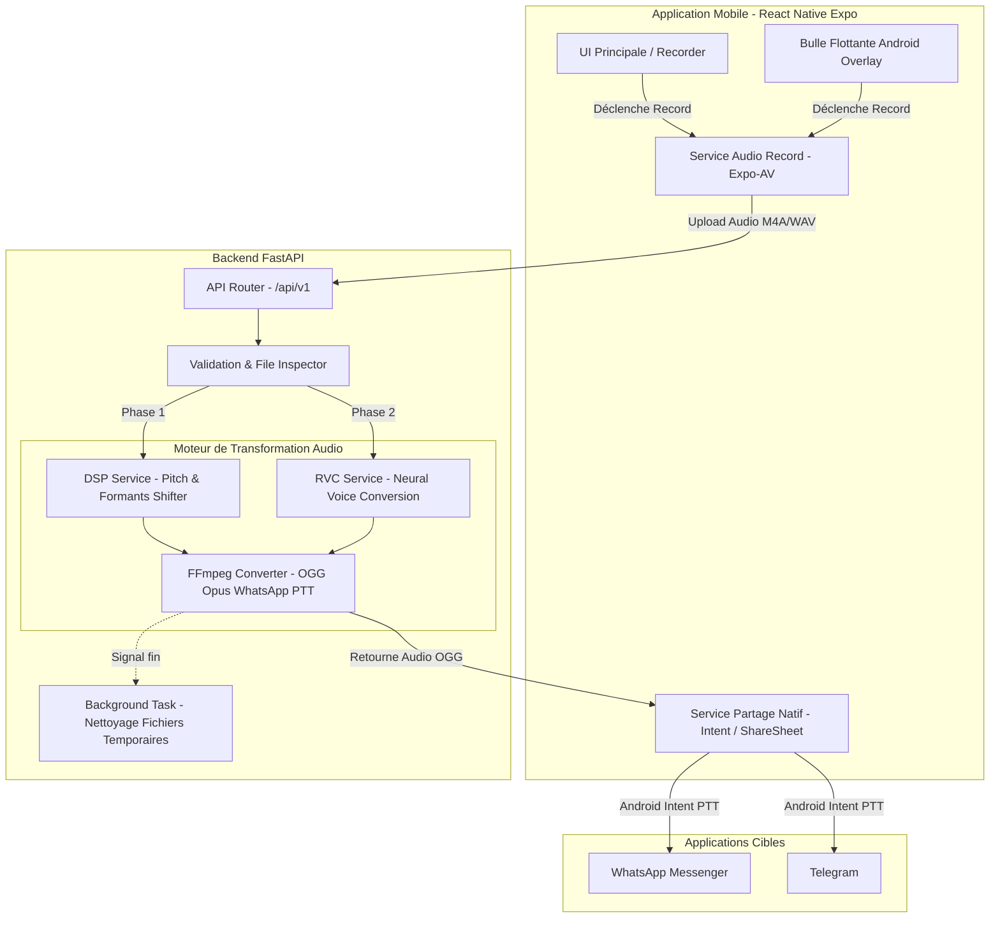
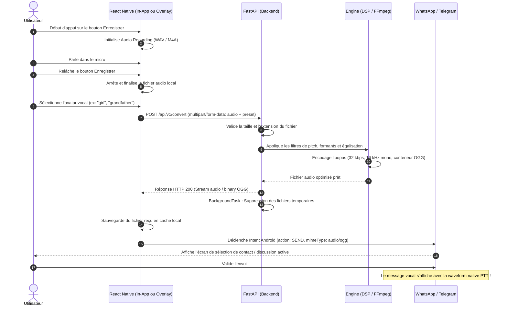

# Architecture & Flux de Données - VoiceMorph

Ce document détaille l'architecture système, les interactions entre composants et le cycle de vie d'un message vocal.

---

## 1. Diagramme d'Architecture Globale

---

## 2. Diagramme de Séquence Détaillé (Cycle de Vie d'un Voice)

---

## 3. Stratégie de Résilience & Performance

- **Latence Cible** : 
  - En Phase 1 (DSP) : Temps de traitement < 500 ms pour un message de 15 secondes.
  - En Phase 2 (RVC) : Temps de traitement < 2000 ms avec GPU.
- **Gestion Mémoire** : Aucun fichier audio n'est stocké en mémoire vive complète dans FastAPI ; ils sont traités via des descripteurs de fichiers temporaires (`tempfile`).
- **Mode Hors-Ligne (Futur)** : Le moteur DSP pourra être compilé en C++ natif (WebAssembly ou bibliothèque C++ via JSI) directement dans l'application mobile pour fonctionner sans connexion Internet.

